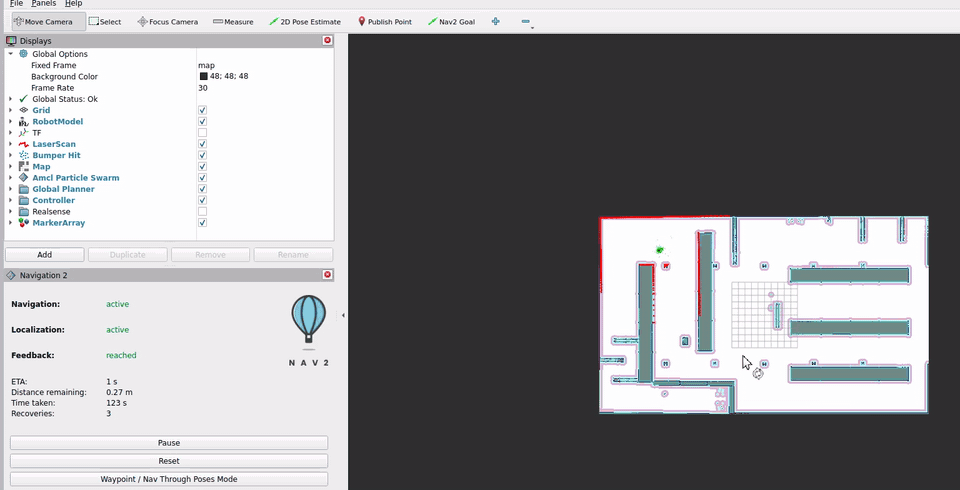

# TurtleBot 4 NavLab

ROS 2 Jazzy · Gazebo Harmonic · TurtleBot 4 · Nav2

基于官方 warehouse 场景的移动机器人导航基线：固定起点、8 个经规划器复核的目标、24 次重复试验。目的是得到可重复的量化结果，而不是单次演示。



*RViz 中的一次导航过程（约 6 分钟实时，24 倍速压缩）。红色为 Nav2 规划的全局路径，左下角为实时状态：剩余距离、已用时间、恢复次数。*

## 结果

| 项目 | 内容 |
| --- | --- |
| 场景 | Gazebo `warehouse`，AMCL 定位，`turtlebot4_navigation` 默认参数未做修改 |
| 起点 | `S0 = map (0, 0, 0)`，每次启动自动注入 |
| 目标 | 8 个，按实际规划路径分为 simple / turning / narrow / long |
| 试验 | 每目标 3 次，共 24 次，每次试验前重启整套仿真 |
| 成功率 | 24 / 24 |
| 单次导航耗时 | 29–205 s（仿真时间） |

指标定义与逐目标结果见 [官方基线结果](docs/baseline.md)。

## 快速开始

```bash
cd ~/turtlebot4_ws/src/turtlebot4-navlab
./scripts/start_navigation.sh                    # Gazebo + Nav2 + AMCL，起点自动固定为 S0
TRIALS=3 ./scripts/run_batch.sh                  # 8 个目标 x 3 次，逐个重启、自检、记录
/usr/bin/python3 scripts/summarize_results.py    # 生成结果表
```

环境要求见 [复现与启动指南](docs/reproduction.md)。起点由 `config/localization.yaml` 固定，无需使用 RViz 的 2D Pose Estimate。

## 三个关键实现决策

### 起点位置的确定

官方启动脚本把机器人放在 Gazebo 世界原点，而 Nav2 需要的是 `map` 坐标系下的起点。手工在 RViz 里拖 2D Pose Estimate 既不可复现，也无法判断对错 —— 两次拖拽会得到两个不同的值，且没有任何依据说明哪个更准。

改用可验证的方法：取一帧 `/scan`，沿 URDF 链条（`base_link → shell_link → rplidar_link`）变换到车体系，再与 `warehouse.pgm` 的距离变换做拟合。`(0, 0, 0)` 的平均残差为 **0.012 m**；作为对照，早期手拖的取值 `(-0.094, -0.122, -3.122)` 残差为 **3.14 m**，yaw 相差约 180°。

起点写在 `config/localization.yaml` 的 `initial_pose` 中，启动时自动注入 AMCL，全程无需手工操作。

### 目标难度的判定

坐标距离近不等于路线简单。8 个目标全部经 Nav2 规划器实际规划，记录路径长度、累计转角、转角密度和最窄通行宽度，据此分为 simple / turning / narrow / long 四类，而不是按目标坐标估计。

判据固化在 `scripts/check_paths.py` 中：每次实验前先自检，任一项偏离基线即中止，避免环境漂移污染整批数据。

### 试验条件的可复现

每次试验之间重启整套仿真，使 Gazebo 的出生位姿与 AMCL 的初始位姿回到同一状态，起点才真的是同一个起点。批量流程由 `scripts/run_batch.sh` 完成：逐条启动、等待 Nav2 就绪、执行环境自检、发送目标、记录结果、关闭仿真，再进入下一条；中断后重跑会跳过已完成的试验。

统计口径同样固定：被墙钟超时打断的记录不构成导航结果，不计入失败统计，规则见 [实验记录](docs/experiment_logging.md)。

## 文档

| 文档 | 内容 |
| --- | --- |
| [复现与启动](docs/reproduction.md) | 首次运行、环境检查、确认初始定位、发送目标、退出仿真 |
| [目标集与难度定义](docs/goal_set.md) | 8 个导航目标、难度判据与复核方法 |
| [官方基线结果](docs/baseline.md) | 基线条件、结果表、指标口径与复跑方式 |
| [实验记录](docs/experiment_logging.md) | 自动记录流程、结果分类规则、仿真速度门禁 |
| [结果目录](results/README.md) | 输出位置、字段含义与本地数据管理 |
| [环境排障](docs/troubleshooting.md) | 图形、雷达、TF、控制器或构建问题 |

## 环境

- Ubuntu 24.04 / WSL2
- ROS 2 Jazzy
- Gazebo Harmonic
- TurtleBot 4 Simulator
- Nav2

已验证的版本与检查命令见 [环境要求](docs/reproduction.md#环境要求)。启动脚本包含 NVIDIA D3D12 相关设置，面向 WSL2 环境；其他显卡或原生 Linux 环境需要单独验证。

## 数据与版本库

原始运行数据（`results/runs/`、`summary.csv`、批量日志）不纳入版本库，`results/` 只保留说明文档与表头模板 `summary.example.csv`。历史批次归档在同一目录下，可用 `scripts/summarize_results.py --runs <目录>` 重新生成对应结果表。

## 上游项目

- [turtlebot/turtlebot4_simulator](https://github.com/turtlebot/turtlebot4_simulator)
- [ros-navigation/navigation2](https://github.com/ros-navigation/navigation2)
