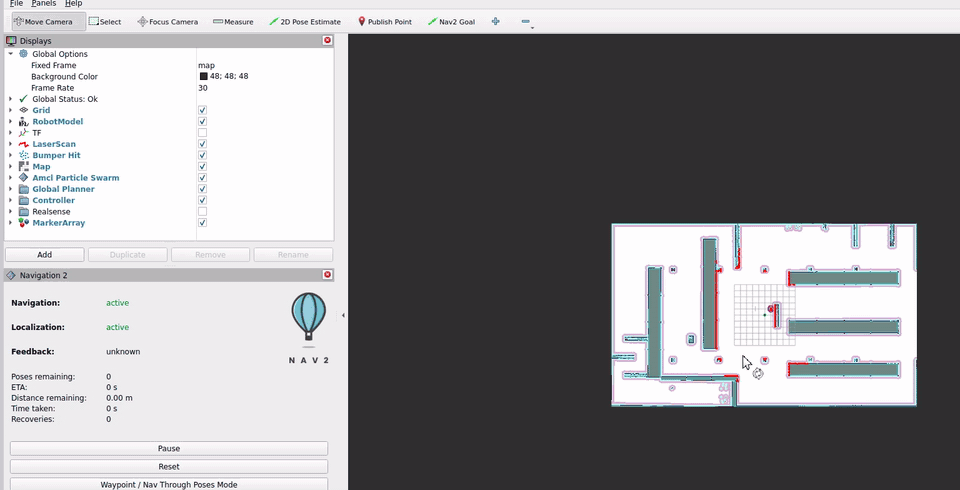
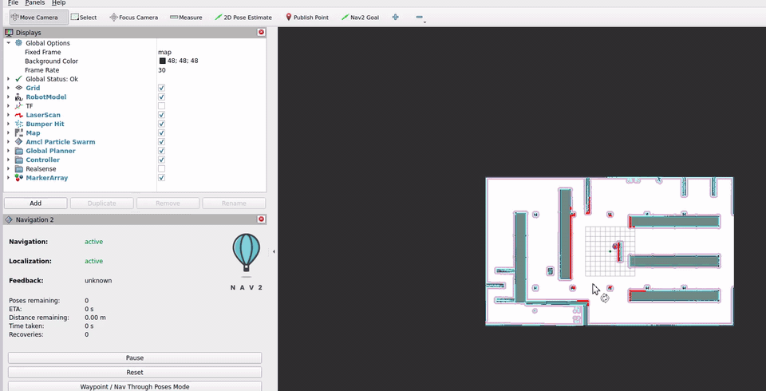

# 局部控制器对比

在同一个起点、同一套目标、同一份参数文件上，只替换 Nav2 的局部控制器（`controller_server` 的 `FollowPath` 插件），看三种控制律在同一批任务上的差别。

[返回首页](../README.md) · [官方基线结果](baseline.md) · [目标集与难度定义](goal_set.md) · [实验记录](experiment_logging.md)

## 方法

三份参数文件由脚本从 `turtlebot4_navigation` 的 `nav2.yaml` 生成，**除 `controller_server` 的 `FollowPath` 块之外逐字段一致**（已用 YAML 深度比对验证）。因此三臂之间唯一的配置变量就是控制律。

| 臂 | 插件 | 参数来源 |
| --- | --- | --- |
| `mppi` | `nav2_mppi_controller::MPPIController` | 上游配置原文，未改 |
| `rpp` | `nav2_regulated_pure_pursuit_controller::RegulatedPurePursuitController` | 插件默认值，仅把速度上限对齐 |
| `graceful` | `nav2_graceful_controller::GracefulController` | 插件默认值，仅把速度上限对齐 |

三臂的速度上限统一为 **0.5 m/s**（上游 MPPI 的 `vx_max`），避免把"谁默认跑得快"误当成"谁控制得好"。

其余条件与官方基线完全相同：固定起点 `S0 = map (0, 0, 0)`、8 个目标、每次试验前重启整套仿真、试验前跑 `scripts/check_paths.py` 自检。

"配置相同"不等于"条件相同"：RPP 与 Graceful 用的是插件默认参数，这是一次**默认配置对比**，不是调过参之后的算法优劣对比。

## 结果

每个目标一次试验（`TRIALS=1`）。单元格为「导航耗时（仿真时间）/ 恢复次数」。

| 目标 | 类别 | 规划路径 | MPPI | RPP | Graceful |
| --- | --- | --- | --- | --- | --- |
| G01 | simple | 7.88 m | 49.7 s / 3 | 59.5 s / 3 | 42.4 s / 1 |
| G02 | simple | 7.57 m | 31.5 s / 0 | 30.4 s / 0 | 31.6 s / 0 |
| G03 | turning | 24.78 m | 136.7 s / 5 | 127.1 s / 4 | 126.0 s / 4 |
| G04 | turning | 24.23 m | 174.3 s / 8 | 171.2 s / 8 | **138.2 s / 5** |
| G05 | narrow | 26.31 m | 176.5 s / 7 | 中止 * | 中止 * |
| G06 | narrow | 8.28 m | 39.9 s / 0 | 33.6 s / 0 | 36.3 s / 0 |
| G07 | long | 42.57 m | 194.3 s / 4 | 201.7 s / 4 | 201.4 s / 6 |
| G08 | long | 39.82 m | 187.7 s / 4 | 182.4 s / 3 | 176.9 s / 3 |

\* 这两个中止在下面的复跑中没有复现。

三个臂都成功的目标（G01–G04、G06–G08 共 7 个）：

| 臂 | 共同目标上的平均耗时 | 平均恢复次数 |
| --- | --- | --- |
| MPPI | 116.3 s | 3.43 |
| RPP | 115.1 s | 3.14 |
| Graceful | **107.6 s** | **2.71** |

## G05 复跑：两次中止没有复现

批次记录里 G05 是最有区分度的目标：MPPI 通过，RPP 与 Graceful 中止。为了给这一结论留下可看的证据，用同一批配置把三个臂各重跑了一次（界面开着 RViz，因此宿主比批次时更慢，`rtf` 更低）。

| 臂 | 批次记录（10-28 白天） | 复跑（10-28 19:30–20:30） |
| --- | --- | --- |
| MPPI | 成功 176.5 s / 7 次恢复 | **成功**，墙钟 1083 s，`Failed to make progress` 7 次 |
| RPP | **中止**，净前进约 2 m，15 次恢复，`Failed to make progress` 14 次 | **成功**，墙钟 949 s，`Failed to make progress` 6 次 |
| Graceful | **中止**，净前进约 8.3 m，19 次恢复 | **成功**，墙钟 828 s，`Failed to make progress` 4 次 |

三段录屏（约 40–50 倍速，结束后由动作结果确认状态）：

| MPPI | RPP | Graceful |
| --- | --- | --- |
|  |  |  |
| 成功 · 178 s 时剩 2.66 m | 成功 · 160 s 时剩 2.84 m | 成功 · 138 s 时剩 3.32 m |

录屏由 Windows 侧 `gdigrab` 抓取，帧率跟不上仿真时钟，所以片段在到达目标前几十秒结束；最终状态以动作接口返回为准：三次都是 `SUCCEEDED`、`error_code 0`。三次运行的完整日志在 `~/turtlebot4_ws/log/navlab/record_g05_{mppi,rpp,graceful}.log`，未通过 `experiment_log.py` 记录，因此不进入 `results/` 数据集。

### 这次复跑改变了什么

同一份配置、同一个目标、同一台机器，RPP 与 Graceful 在批次里中止、在复跑里走完全程。两次中止的机制是同一条：`nav2_behaviors` 的进度检查在连续多次判定"没有进展"后让 BT 放弃。这个判定对宿主丢指令、局部代价地图的瞬时膨胀都敏感，而它每次运行出现的次数是随机的：

| 臂 | 批次 `Failed to make progress` | 复跑 `Failed to make progress` | 批次 `cmd_vel` 丢弃 | 复跑 `cmd_vel` 丢弃 |
| --- | --- | --- | --- | --- |
| MPPI | 6 | 7 | 41 | 40 |
| RPP | 14 | **6** | 36 | 40 |
| Graceful | 4 | 4 | 82 | **2** |

RPP 的 14 次与 6 次是同一份配置；Graceful 的 `cmd_vel` 丢弃数从 82 掉到 2 也没有伴随任何参数变化。复跑时宿主更慢（开着 RViz），却全部成功，说明"RTF 低"本身不足以解释中止。

因此批次表里 G05 的那一行不能读成"控制律差异"。它是**一次会随机发生的中止**落在了 RPP 与 Graceful 上，没有落在 MPPI 上。

### 早期的一处错误推理

最初把 RPP 的中止解释为"`lookahead_dist` 0.6 m 比通道 0.55 m 宽，所以转弯切角卡住"。这个推理是错的：前视距离是沿路径的弧长，通道宽度是横向空间尺度，量纲不同，不能直接比大小。要判断真实原因需要 footprint 与膨胀后的代价地图、局部路径曲率、以及失败时刻实际发出的 `cmd_vel`，这些当前都没有采集。

## 结论

**1. 单次试验不足以判定控制律优劣，这一条被自己的数据推翻了。**

G05 在批次里看起来是唯一有区分度的目标，复跑后三个臂全部通过。同一个臂在两次运行中给出相反结果，说明在 RTF ≈ 0.2–0.3 的宿主上，一次运行的成败主要反映宿主抖动，而不是控制律。任何"某个控制器过不了窄通道"的说法，在没有重复试验前都不成立。

**2. 简单与短距离目标上三者没有区别。**

G02 三者 30.4–31.6 s、恢复次数全部为 0；G06 33.6–39.9 s、同样全部为 0。这一条不依赖对失败原因的推断，也不依赖单次运行的运气：三类控制律在无障碍短程任务上的表现差异小于运行抖动。

**3. 转弯路线上 Graceful 省时，但仍是单次观察。**

G04：138.2 s / 5 次恢复，对比 MPPI 174.3 s / 8 次 —— 耗时低 21%、恢复次数少 37%。方向与 Graceful 的设计一致（接近目标时主动减速而非急转），但没有重复样本，不能当作结论。G03 上三者接近（126–137 s），看不出同样的趋势。

## 局限

- **宿主速度低于门禁。** 三个臂的 `rtf_estimate` 平均值为 MPPI 0.207、RPP 0.252、Graceful 0.255，全部低于 [实验记录](experiment_logging.md) 里的 0.5 预跑门禁；批次顺序也没有平衡，先跑的臂比后跑的低约 20%。仿真时间指标不受 RTF 直接影响，但 `cmd_vel` 时间戳过期率受它影响，而指令有没有生效直接决定车能不能动。
- **每个目标只有一次批次试验。** 复跑只覆盖了 G05 一个目标，其余 7 个目标的差异仍未验证稳定性。
- **RPP 与 Graceful 未调参**，只对齐了速度上限。这是默认配置对比，不是调优后的算法对比。
- **中止原因未定位。** 已确认机制是进度检查连续判定无进展，但没有采集失败时刻的局部代价地图、局部路径曲率与 `cmd_vel`，因此无法说明为什么某一次会连续触发。
- **恢复次数只是次数**，不含恢复类型（清代价地图 / 旋转 / 后退），也未采集碰撞数据（自动记录没有可靠来源，见 [实验记录](experiment_logging.md)）。
- 只在 warehouse 场景、DiffDrive 底盘、0.5 m/s 速度上限下成立，换场景或速度需要重测。

## 复现

```bash
cd ~/turtlebot4_ws/src/turtlebot4-navlab

# 三个臂各跑一遍，每次跑完自动归档到 results/archive/ctl_<arm>/
./scripts/run_controller_matrix.sh

# 单独跑某一臂
CONTROL=rpp TRIALS=1 ./scripts/run_batch.sh

# 并排对比
/usr/bin/python3 scripts/compare_arms.py \
  mppi=results/archive/ctl_mppi/runs \
  rpp=results/archive/ctl_rpp/runs \
  graceful=results/archive/ctl_graceful/runs
```

启动时 `scripts/start_navigation.sh` 会打印当前生效的控制臂，运行中可用 `ros2 param get /controller_server FollowPath.plugin` 确认。

要判断控制律优劣，需要把 `TRIALS` 提到 3 以上并让三个臂在相同负载下交替运行；在当前宿主上，这大约需要 10 小时。
